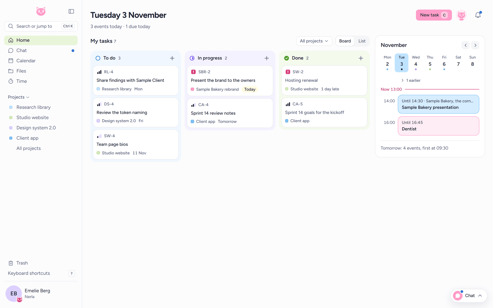
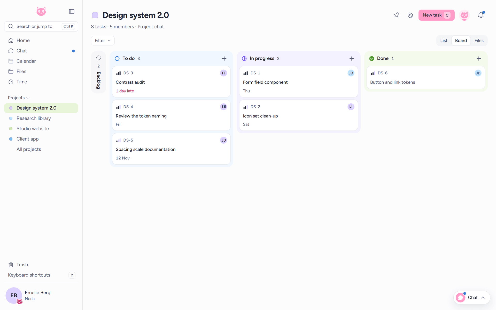
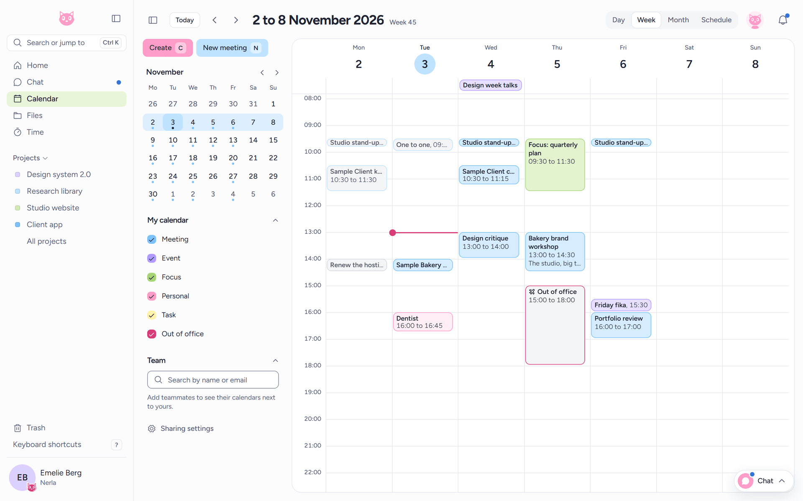
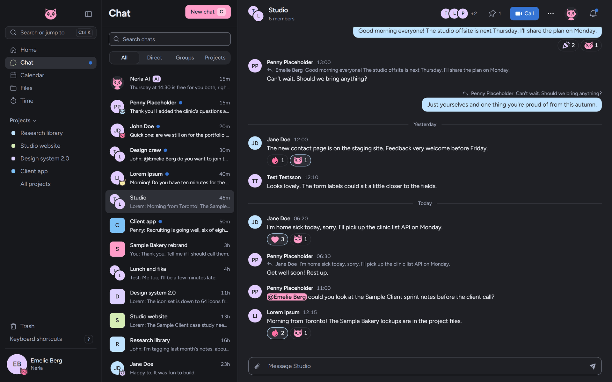
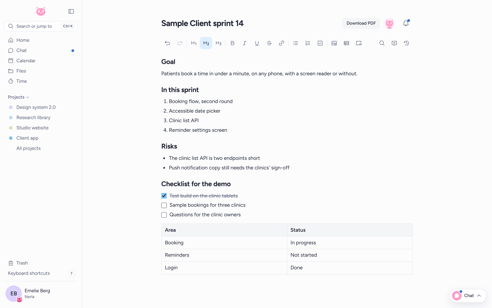
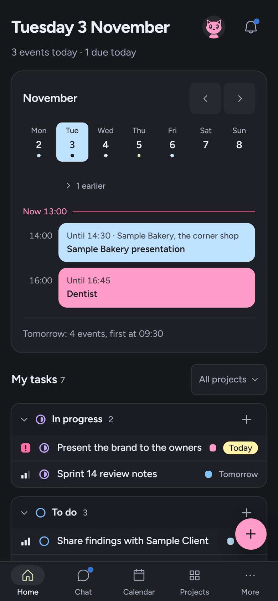
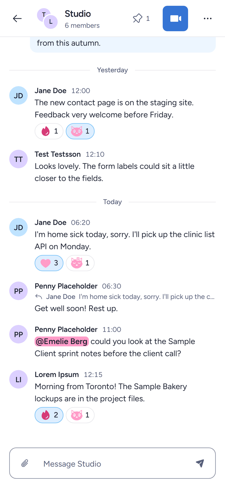
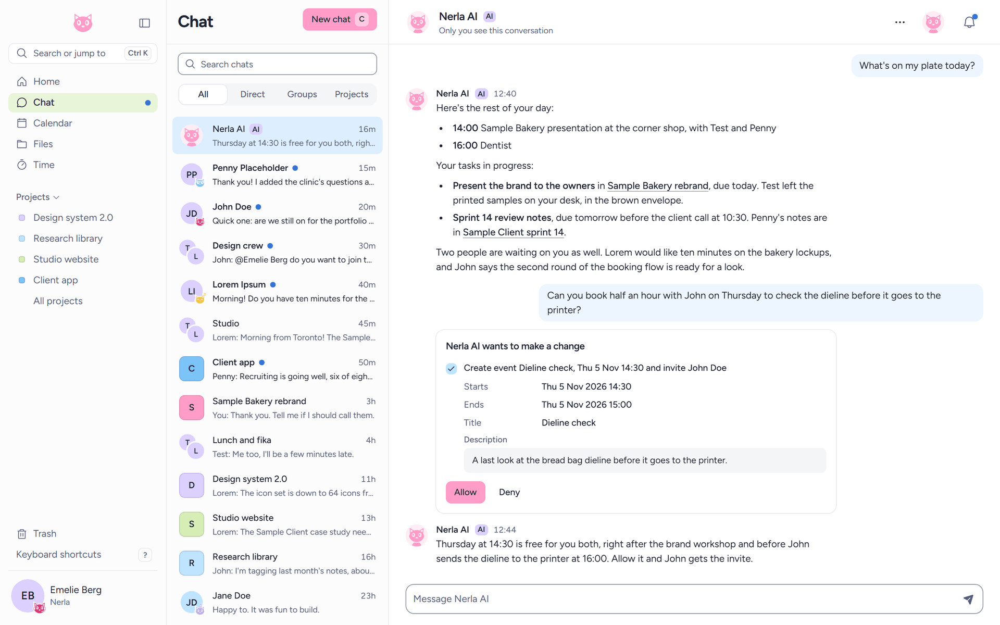

# Nerla

Nerla is an open-source workspace you run on your own server. Tasks and projects, a calendar, chat and calls, papers and boards, files and time tracking live in one app, with an AI teammate included. Your data stays on your server, and Nerla sends nothing home.

Nerla is meant to add a bit of whimsy to your workday and make work (hopefully) a little more fun.




## What's inside

### Home

Home shows your day at a glance: your tasks across every project as a board or a list, and today's events next to them. Press `Ctrl K` anywhere to search or jump to a task, a project, a file or a teammate.

### Tasks and projects

A project is a shared space with its own members, board, chat and files. Tasks have a status, a priority, an assignee and a due date, and a project's tasks get a short number such as `WEB-12`. Tasks without a project are personal and belong to you alone.



### Calendar

Events, repeating series, guests, out of office and working hours. Team view shows your teammates' calendars side by side, so finding a time that suits everyone takes one look.



### Chat and calls

Direct messages, group chats and a chat for every project, with replies, reactions, mentions and files. Start a video call from any chat, present your screen, and let guests from outside the workspace in through a lobby. A small chat window stays open in the corner while you work elsewhere in the app.



### Papers and boards

Papers are documents and boards are whiteboards. Both are edited live together. They live with your other files inside Nerla, so they share the same folders.



### Files

Folders, uploads and previews, shared with teammates or through an outside link. Anything deleted waits in Trash for 30 days before it is gone.

### Time tracking

Start a timer or log time by hand. The week view suggests entries from your meetings and the tasks you worked on, and reports export to CSV. An admin turns time tracking on for the workspace.

### On a phone

Nerla works in a phone's browser too, with a layout made for small screens. Currently there's no mobile app available.

<p>
  
  
</p>

## The AI teammate and agents

The AI teammate has its own chat, where you can ask what is on your plate, plan a meeting or tidy up a project. You can also mention it in a group chat, a task's comments or a paper's comments, and it answers there. Outside agents, such as Claude Desktop or a script in your editor, can connect over MCP with a personal access token.



Both follow the same rules:

- **They act as you.** The AI and your agents can only do what you could do by clicking through the app yourself. They never see more than you can see.
- **They ask before changing what others can see.** Once the AI has read something written by someone else, any change other people would see waits for you to press Allow. Text someone planted in a message can never act through the AI behind your back.
- **In a shared chat, they only use what everyone there can see.** When the AI needs your own tasks or calendar to answer, it asks you first, and shows you the answer before anyone else sees it.
- **You set how careful they are.** An admin picks a level for the workspace, from "before every change" to "only before sensitive actions". You can choose a stricter level for yourself, never a looser one.
- **An admin can switch them off at once.** The AI teammate and MCP access each have their own switch, and turning one off stops it straight away.

Nerla brings no model of its own. An admin connects any model that speaks the OpenAI chat completions API with tool calling, such as Ollama or LM Studio on your own hardware, or a hosted service such as OpenRouter.

## Self-hosted and private

Nerla runs on one Linux server that you control, in Docker. Your tasks, messages, files and calls stay there.

**Nerla sends nothing home.** It has no telemetry, no analytics and no error reporting. Fonts, scripts and images are served from your own server. It only talks to services you set up yourself, such as your mail server, your file storage or your AI model, plus the few lookups an install needs to get its certificate and run calls. [SETUP.md](SETUP.md#nerla-sends-nothing-home) lists every one.

The install is secure by default: HTTPS with a free certificate, strong secrets made for you, a firewall, rate limits, and a database that is never reachable from the internet.

## The desktop app

There is a desktop app as well. Download the installer from the [releases page](../../releases), open it, and enter your server's address, such as `https://nerla.example.com`. It has native notifications, and calls open in a window of their own that can shrink to a small window on top.

The app keeps itself up to date. When it starts, it checks the releases page for a newer version, and it only installs an update signed with Nerla's release key.

### The first time you open it

The installers aren't signed with a paid Apple or Microsoft certificate. So the first time you open the app, your computer asks if you trust it. You only do this once, and updates install without asking again.

- **macOS:** macOS says it can't check the app. Open **System Settings**, then **Privacy & Security**, scroll down and press **Open Anyway** next to Nerla.
- **Windows:** a blue window says "Windows protected your PC". Press **More info**, then **Run anyway**.
- **Linux:** the AppImage updates itself. With the `.deb` or `.rpm` package, install a new release from the releases page when one comes out.

## Getting started

On a Linux server with a domain pointing at it:

```bash
curl -fsSL https://get.docker.com | sh
git clone https://github.com/Emmyme/nerla.git nerla && cd nerla
sudo ./setup.sh
```

Then open your domain in a browser and create the first account, which becomes the admin. [SETUP.md](SETUP.md) covers everything else: what you need, configuration, email, file storage, updates, backups and troubleshooting.

## More

- [SETUP.md](SETUP.md), installing and running Nerla
- [CONTRIBUTING.md](CONTRIBUTING.md), working on Nerla's code
- [SECURITY.md](SECURITY.md), reporting a vulnerability and checking a release's signature
- [LICENSE](LICENSE), Nerla is MIT licensed
