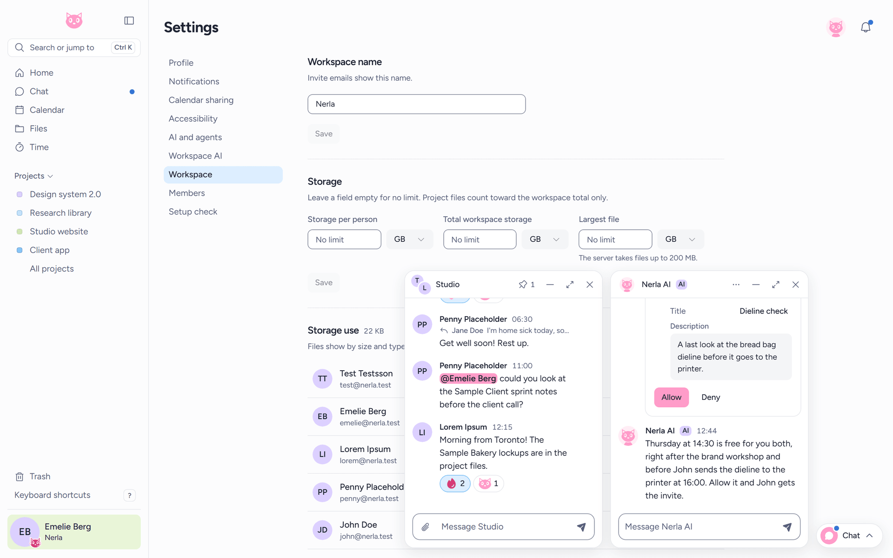
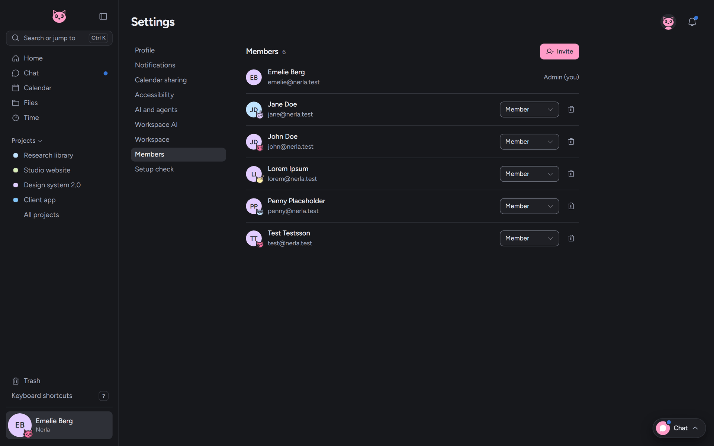
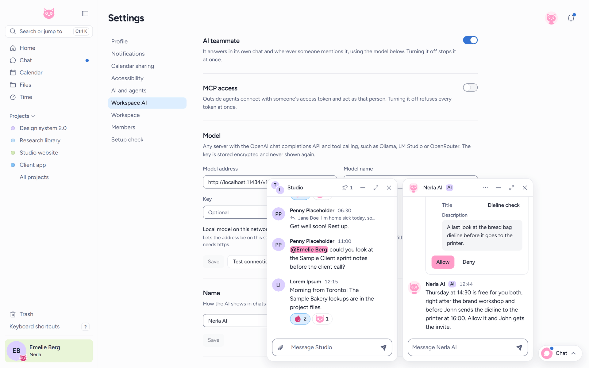
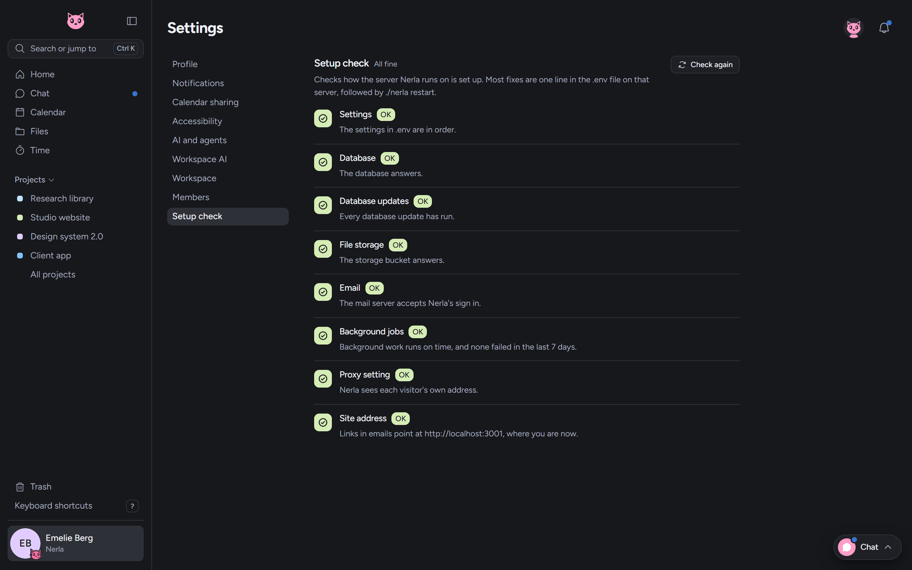

# Setting up Nerla

This guide covers everything about running your own Nerla: what you need, installing, the first sign-in, keeping the install up to date and backed up, every important setting, and what to do when something goes wrong. For what Nerla is, see the [README](README.md). For working on the code, see [CONTRIBUTING.md](CONTRIBUTING.md).

- [What you need](#what-you-need)
- [Install](#install)
- [First sign-in](#first-sign-in)
- [Managing your install](#managing-your-install)
- [Configuration](#configuration)
- [Troubleshooting](#troubleshooting)

## What you need

1. **A Linux server**, such as a small VPS from Hetzner, DigitalOcean, Vultr or Linode. 2 GB of RAM and 10 GB of free disk are recommended, and 1 or 2 CPUs are enough for a small team. Setup warns when the server has less.
2. **A domain name**, such as `nerla.example.com`, whose DNS A record you can point at the server. Without one, Nerla can run on the server's IP address with a certificate of its own, see [HTTPS and certificates](#https-and-certificates).
3. **Docker** with the compose plugin, and `git`.
4. **These ports open to the internet**: 80 and 443 for the website, 7880/tcp for call signalling, and 7881/tcp and 7882/udp for call audio and video. Setup opens them in UFW for you when UFW is installed. Ports 80 and 443 must be free, so stop any web server that already uses them, often with `sudo systemctl disable --now apache2`. If you want to keep a proxy of your own on 80 and 443, see [Running behind your own proxy](#running-behind-your-own-proxy).
5. **About 15 minutes.**

### What gets installed

Everything runs in Docker:

| Service | What it does |
|---------|--------------|
| `web` | Caddy with the website inside. It serves the app, gets and renews the HTTPS certificate, sets the security headers and passes the API and call signalling on |
| `server` | The Nerla API, live updates and background jobs |
| `postgres` | The database, PostgreSQL 15 |
| `garage` | A small S3-compatible store for uploaded files |
| `livekit` | The video call server |

Only `web` and the call ports face the internet. The database and the file store have no published ports.

## Install

On the server:

```bash
# 1. Install Docker, if it isn't there yet
curl -fsSL https://get.docker.com | sh

# 2. Get Nerla
git clone https://github.com/Emmyme/nerla.git nerla && cd nerla

# 3. Point your domain's DNS A record at this server's IP address,
#    in your domain registrar's dashboard

# 4. Run setup and answer its questions
sudo ./setup.sh
```

Setup asks for your domain (or the server's IP address), an optional email for Let's Encrypt, and optional mail server details. Then it does the rest:

- moves to the newest release and downloads its signed images (before the first release, it builds them from source)
- writes `.env` with strong, random secrets, readable only by its owner
- waits until your domain points at the server, so the certificate request doesn't fail
- starts every service and sets up the file store and its keys
- gets a free HTTPS certificate from Let's Encrypt, which the web proxy renews on its own
- opens the firewall for the ports above, if UFW is installed
- schedules a nightly backup at 02:00
- checks the site from the outside and tells you what failed, if anything

Setup is safe to run again. It keeps your settings and fills in only what is missing.

To build from source instead of downloading release images, set `NERLA_BUILD=source` in `.env` before you run setup.

## First sign-in

Open `https://your-domain` and create an account. The first account becomes the admin. Nobody else can sign up on their own, everyone else joins through an invite.

Admins find these pages under **Settings**:

- **Workspace**: the workspace name that invite emails show, and storage limits per user, for the whole workspace and per file.
- **Members**: invite people, change their role, and remove them.
- **Workspace AI**: the AI teammate and MCP access switches, the AI model, and how careful the AI must be.
- **Setup check**: how the server is set up, with a fix for each problem. See [Setup check](#setup-check).



### Inviting people

Under **Settings**, **Members**, press **Invite** and enter an email address. Nerla gives you a link to copy and send yourself, in a chat or in person, whether or not email is set up. A link lasts 7 days. Pending invitations stay listed, where **New link** makes a fresh one (the old link stops working) and **Revoke** cancels the invite.

With [email](#email-optional) set up, the invite is also emailed. Each pending invitation then shows what happened to its email: *Sending*, *Email sent* or *Email failed*. When it failed, press **New link** or send the link yourself.



### Turning on the AI

The AI teammate needs a model. Under **Settings**, **Workspace AI**, enter the address and name of any server with the OpenAI chat completions API and tool calling, such as Ollama, LM Studio or OpenRouter, plus its key if it needs one. **Test connection** checks it. The key is stored encrypted with `AI_MASTER_KEY` from `.env` and never shown again. Then turn on **AI teammate**, and **MCP access** if people should connect outside agents with their own access tokens.

A model on this server or its network, such as Ollama on the same machine, needs the **Local model on this network** option. Without it, the address must use `https`.



## Managing your install

### The nerla command

Run these from the install folder:

```bash
./nerla status            # is each service running and healthy?
./nerla doctor            # check the site answers over HTTPS, then run the setup check
./nerla check             # list setup problems and how to fix each
./nerla logs [service]    # follow the logs, of everything or of server, web, postgres, garage or livekit
./nerla update [--force]  # check, back up, move to the newest release and restart
./nerla restart [service] # restart and read .env again
./nerla stop [service]    # stop everything, or one service (your data is kept)
./nerla start [service]   # start everything again, or one service
./nerla build             # build the images from source, for a source install
./nerla backup            # back up now
./nerla restore <folder>  # put a backup back
./nerla move-files --to local|s3 [--delete-source]  # move every file to the other store
./nerla support-bundle    # collect logs and settings, with every secret removed
```

Anything else is passed to `docker compose` with the right files, so `./nerla ps` or `./nerla cp` work too.

After you change `.env`, run `./nerla restart server` (or `./nerla restart` when the change concerns the web proxy) so the change is read.

### Updating

Run `./nerla update`. It does these steps in order, and stops at the first that fails:

1. Runs the [setup check](#setup-check) and stops if it finds a problem. `./nerla update --force` updates anyway.
2. Backs up the database, the files and the settings, so a bad update can be undone.
3. Moves to the newest release and downloads its images. If the download fails, the version you had keeps running. On a source install, or before the first release, it builds instead, and a failed build also leaves the old version running.
4. Restarts, and waits up to two minutes for the server to answer. As the server starts, it brings the database up to date.

You can update from any older version in one step. Each database change runs once, and two starts at the same time wait for each other.

If the new version doesn't start, `./nerla update` ends with an error and shows the server's `FATAL:` lines. [Start messages](#start-messages) explains each one. Once you fix the cause, `./nerla restart server` tries again.

To go back to the version you had, run the commands `./nerla update` printed. They name the commit you were on:

```bash
git checkout <previous commit>
./nerla start
```

On a source install, run `./nerla build` before `./nerla start`. That runs the old version on the data as it is now. A database update that failed keeps nothing, so this is usually all you need. Only if the data itself must go back to how it was before the update, also run `./nerla restore <backup>` with the backup the update made, which it printed too. A restore alone is not a way back, since it keeps the new version, which runs the same database update again. Once a fixed version is out, run `git checkout main` and `./nerla update`.

### Backups

`./nerla backup` backs up right now. Setup also schedules one every night at 02:00, and `./nerla update` backs up before it changes anything. Each backup is a folder in `backups/` named by its time, kept for 30 days. `BACKUP_DIR` in `.env` saves them somewhere else and `BACKUP_RETENTION_DAYS` keeps them longer or shorter.

A backup holds:

- the database, as `postgres.dump`
- the uploaded files, as `garage-meta.tar.gz` and `garage-data.tar.gz`, or as `files.tar.gz` when files are on the server's own disk. Files in an S3 store of your own stay there and are not in the backup, so turn on that provider's versioning or backups
- the settings, as copies of `.env` and `garage.toml`
- the web proxy's certificates, as `caddy-data.tar.gz`, so a restore never has to ask Let's Encrypt again
- a `MANIFEST` with the time, the version and the last database change

The app keeps running during a backup, so a file deleted while it runs can be in the database copy and missing from the file copy. A backup that did not finish is marked `INCOMPLETE` and can't be restored.

> **A backup holds the install's passwords and keys**, because it holds `.env`. Only its owner can read it. Keep every copy as private as the server itself.

> **Backups on the server do not survive losing the server.** Copy them elsewhere regularly, for example:
> `rsync -az backups/ you@another-host:/nerla-backups/`

### Restoring

Run `./nerla restore backups/<time>`. Run `./nerla restore` alone to list the newest backups.

It checks the whole backup first and asks you to type `restore`. Then it stops the app, replaces the database and the files, and starts the app again. The result matches the backup exactly, with no rows or files left over from before. If the backup's settings differ from the ones in use, it asks which to keep, and the backup's are the default, since its passwords and storage keys match its data. Your previous `.env` is saved as `.env.before-restore`.

A backup from a newer version of Nerla is refused, so update first.

### Setup check

Admins find a **Setup check** page under **Settings**. It lists each part of the install as OK, a warning or a problem, problems first, each with how to fix it and a link to the part of this guide that explains more. The Setup check item in the settings menu shows how many problems there are, so a broken mail setup gets noticed without opening the page. `./nerla check` runs the same checks on the command line and ends with an error when it finds a problem.



Most fixes change a setting in `.env`. After changing one, run `./nerla restart server`, then press **Check again** or run `./nerla check`.

## Configuration

### Settings in .env

All settings live in `.env` in the install folder. Setup writes it, and `.env.example` lists every setting with a comment. You rarely need to edit it by hand. When the setup check says a setting is missing, too weak or not valid, the message names it and what it needs. Setup makes every secret, so running `sudo ./setup.sh` again is the safest fix for a missing one.

After any change, run `./nerla restart server`.

| Setting | What it does |
|---------|--------------|
| `CLIENT_URL` | The address people open, such as `https://nerla.example.com`. Links in invites and emails use it. See [Site address](#site-address) |
| `LIVEKIT_PUBLIC_URL` | The address calls connect to, `wss://<your domain>:7880`. Setup sets it. Calls fail without it |
| `SITE_ADDRESS`, `TLS_MODE`, `ACME_EMAIL` | The domain the web proxy answers on and how it gets its certificate. See [HTTPS and certificates](#https-and-certificates) |
| `SIGNAL_ADDRESS`, `WEB_HTTP_PORT`, `WEB_HTTPS_PORT`, `WEB_SIGNAL_PORT` | Only for [running behind your own proxy](#running-behind-your-own-proxy) |
| `TRUST_PROXY` | How many proxies stand in front of the server. See [Proxy setting](#proxy-setting) |
| `NODE_ENV` | `production` on an install. The server refuses to start when it is unset or misspelled |
| `JWT_SECRET` | Signs sign-in sessions. At least 32 characters. Changing it signs everyone out |
| `DB_USER`, `DB_PASSWORD`, `DB_NAME` | The database login. Setup makes the password |
| `DB_SSL` | `true` to require TLS to the database. The bundled database has no TLS, so keep `false` with it |
| `LIVEKIT_API_KEY`, `LIVEKIT_API_SECRET` | The call server's key pair. Setup makes them and writes them into `livekit.yaml` too |
| `GARAGE_RPC_SECRET`, `GARAGE_ADMIN_TOKEN` | The bundled file store's own secrets |
| `STORAGE_DRIVER` | `s3` (the default) or `local`. See [File storage](#file-storage) |
| `S3_ENDPOINT`, `S3_REGION`, `S3_BUCKET`, `S3_ACCESS_KEY`, `S3_SECRET_KEY`, `S3_FORCE_PATH_STYLE` | The S3 store. Setup fills them in for the bundled one |
| `EMAIL_HOST`, `EMAIL_PORT`, `EMAIL_USER`, `EMAIL_PASS`, `EMAIL_FROM` | The mail server. See [Email](#email-optional) |
| `MAX_UPLOAD_MB` | The largest upload in MB, 200 by default. Admins can set a lower limit in the app. The web proxy accepts at most 200 MB, so a higher value needs a change in `proxy/Caddyfile` too |
| `AI_MASTER_KEY` | Encrypts the AI model keys saved in Settings. 64 hex characters. Setup makes it and never replaces it, since a new key can't read the saved model keys |
| `BACKUP_DIR`, `BACKUP_RETENTION_DAYS` | Where backups go and how many days they are kept. See [Backups](#backups) |
| `NERLA_BUILD` | `source` builds the images on the server instead of downloading the release's |
| `NERLA_REGISTRY` | Where the release images come from, `ghcr.io/emmyme` by default |
| `MOVE_TO_...` | Only for [moving files to another store](#moving-files-to-another-store) |

Never set these on an install. The server refuses to start in production with them:

- `EXPOSE_RESET_TOKEN=true`, which returns password reset tokens over the API, for local testing only
- `RATE_LIMIT_MAX`, which raises the request limits, for the end-to-end tests only

`PORT`, `SERVER_URL`, `VITE_API_URL` and `VITE_LIVEKIT_URL` are for development only.

### HTTPS and certificates

The `web` service is Caddy with the website inside. It serves the app, passes `/api`, `/ws`, `/health` and `/mcp` to the server and call signalling on port 7880 to LiveKit, and gets its own certificate from Let's Encrypt. It renews the certificate on its own, so there is no cron job to look after. `proxy/Caddyfile` holds its whole setup, including the security headers.

Setup writes three lines to `.env`:

- `SITE_ADDRESS`, the domain the site answers on, such as `nerla.example.com`
- `TLS_MODE`, `acme` for Let's Encrypt
- `ACME_EMAIL`, an email Let's Encrypt may write to. It is optional.

Let's Encrypt checks the domain over port 80, so the domain must point at the server and port 80 must be open. Until it does, the web proxy keeps trying, and HTTPS starts working on its own a few minutes after the domain points here. `./nerla logs web` says why it failed, and `./nerla restart web` makes it try again right away. Nerla only ever asks Let's Encrypt, never another certificate authority.

An IP address or `localhost` can't have a Let's Encrypt certificate. Setup then writes `TLS_MODE=internal`, and the web proxy makes a certificate with a certificate authority of its own. Browsers warn about it until you trust that authority on each computer that opens Nerla. Copy it out with:

```bash
./nerla cp web:/data/caddy/pki/authorities/local/root.crt nerla-root.crt
```

Then add `nerla-root.crt` to your browser or system as a trusted certificate authority.

The certificates live in the `caddy_data` volume, and every backup holds them.

### Running behind your own proxy

When the server already runs a proxy of its own, such as Caddy, nginx or Traefik, that proxy keeps ports 80 and 443 and the certificate, and Nerla's web proxy answers plain HTTP behind it. Put these lines in `.env`, then run `sudo ./setup.sh`, or `./nerla restart` on an install that is already set up:

```bash
SITE_ADDRESS=:80
SIGNAL_ADDRESS=:7880
WEB_HTTP_PORT=127.0.0.1:8080
WEB_HTTPS_PORT=127.0.0.1:8443
WEB_SIGNAL_PORT=127.0.0.1:8880
TRUST_PROXY=2
```

`SITE_ADDRESS=:80` turns off HTTPS and certificates in the web proxy. The three ports move it off 80, 443 and 7880, onto ports only this machine can reach. `TRUST_PROXY=2` tells the server there are two proxies in front, so the sign-in limits see each visitor's own address. `CLIENT_URL` and `LIVEKIT_PUBLIC_URL` keep the `https://` and `wss://` addresses people use.

Your proxy must send the site to `127.0.0.1:8080`, and port 7880 of the same domain, which calls use, to `127.0.0.1:8880`. It must keep the `Host` header, add to `X-Forwarded-For`, pass WebSockets through, allow uploads of 200 MB, and not hold back streamed replies. These examples do all of that. Replace `nerla.example.com` with your domain.

Caddy:

```caddyfile
nerla.example.com {
	reverse_proxy 127.0.0.1:8080
}

nerla.example.com:7880 {
	reverse_proxy 127.0.0.1:8880
}
```

nginx:

```nginx
map $http_upgrade $connection_upgrade {
    default upgrade;
    ''      close;
}

server {
    listen 443 ssl;
    server_name nerla.example.com;
    ssl_certificate     /etc/letsencrypt/live/nerla.example.com/fullchain.pem;
    ssl_certificate_key /etc/letsencrypt/live/nerla.example.com/privkey.pem;
    client_max_body_size 200m;

    location / {
        proxy_pass http://127.0.0.1:8080;
        proxy_http_version 1.1;
        proxy_set_header Host $host;
        proxy_set_header X-Forwarded-For $proxy_add_x_forwarded_for;
        proxy_set_header X-Forwarded-Proto $scheme;
        proxy_set_header Upgrade $http_upgrade;
        proxy_set_header Connection $connection_upgrade;
        proxy_request_buffering off;
        proxy_buffering off;
        proxy_read_timeout 1h;
    }
}

server {
    listen 7880 ssl;
    server_name nerla.example.com;
    ssl_certificate     /etc/letsencrypt/live/nerla.example.com/fullchain.pem;
    ssl_certificate_key /etc/letsencrypt/live/nerla.example.com/privkey.pem;

    location / {
        proxy_pass http://127.0.0.1:8880;
        proxy_http_version 1.1;
        proxy_set_header Host $host;
        proxy_set_header X-Forwarded-For $proxy_add_x_forwarded_for;
        proxy_set_header X-Forwarded-Proto $scheme;
        proxy_set_header Upgrade $http_upgrade;
        proxy_set_header Connection $connection_upgrade;
        proxy_read_timeout 1h;
    }
}
```

Traefik, running on the host or with `network_mode: host` so it reaches `127.0.0.1`, with an entry point for 7880 in its static setup and this file in its file provider. `letsencrypt` is the name of your own certificate resolver:

```yaml
# Static setup, next to your own entry points
entryPoints:
  websecure:
    address: ":443"
  signal:
    address: ":7880"
```

```yaml
# The file provider's file
http:
  routers:
    nerla:
      rule: Host(`nerla.example.com`)
      entryPoints: [websecure]
      service: nerla
      tls:
        certResolver: letsencrypt
    nerla-signal:
      rule: Host(`nerla.example.com`)
      entryPoints: [signal]
      service: nerla-signal
      tls:
        certResolver: letsencrypt
  services:
    nerla:
      loadBalancer:
        servers:
          - url: http://127.0.0.1:8080
    nerla-signal:
      loadBalancer:
        servers:
          - url: http://127.0.0.1:8880
```

### Proxy setting

`TRUST_PROXY` tells the server how many proxies stand in front of it, so it sees each visitor's own address. Without it, every visitor looks like the proxy's one address, and the sign-in limits treat everyone as one user.

- `1` for the bundled web proxy alone, which setup sets
- `2` with [your own proxy](#running-behind-your-own-proxy) in front of it
- `false` when nothing stands in front of the server, since visitors could otherwise fake their address

A count needs the nearest proxy on a private network, as the bundled one is. Otherwise set `TRUST_PROXY` to the proxy addresses, separated by commas.

### Site address

`CLIENT_URL` is the address people use, such as `https://nerla.example.com`. Links in invites and emails point there. The setup check warns when you opened Nerla at another address, since those links would then lead somewhere else.

### Email (optional)

Nerla runs fine without email. Invites always give you a link to send yourself.

With a mail server set up, invites and password resets are emailed too. Any SMTP server works, such as Gmail, Outlook, AWS SES or your own. Setup asks for one, or set these in `.env` and run `./nerla restart server`:

```bash
EMAIL_HOST=smtp.example.com
EMAIL_PORT=587          # 587 for STARTTLS, 465 for TLS
EMAIL_USER=nerla@example.com
EMAIL_PASS=your-app-password
EMAIL_FROM=Nerla <nerla@example.com>
```

Email counts as set up once `EMAIL_USER` and `EMAIL_PASS` are both set. The setup check's **Email** item signs in to the mail server and says whether that works.

Emails are sent in the background and tried again while the mail server is down. A failed email shows on its invitation and on the setup check under **Background jobs**.

Without email, a user who forgot their password can still ask for a reset link, and Nerla writes it to the server log instead of sending it. An admin with access to the server finds it with `./nerla logs server`, in a line that starts with `[email] Not configured`, and passes it on. Invite links that were not emailed are written there too.

### File storage

Uploaded files, avatars and shared files go in one store. `STORAGE_DRIVER` in `.env` picks it, and setup picks the bundled one.

| Choice | What it is | Good for |
|--------|------------|----------|
| Bundled Garage (`s3`, the default) | A small S3 store that runs next to Nerla. Setup makes it and its keys | Most installs. Nothing to sign up for |
| Local disk (`STORAGE_DRIVER=local`) | Files in the `files` volume on the server | A small install that would rather not run S3 |
| Your own S3 store (`s3`) | Any S3-compatible service, set with the `S3_` settings | Files that should live away from the server |

Local disk is simpler, with no second service to look after. S3 keeps files off the server's disk, so a lost server doesn't take them along, and a store of your own can grow without a bigger disk.

**Your own S3 store.** Set these in `.env` and run `./nerla restart server`. The keys go in `S3_ACCESS_KEY` and `S3_SECRET_KEY`, and `S3_BUCKET` names a bucket that already exists.

| Provider | `S3_ENDPOINT` | `S3_REGION` | Other |
|----------|---------------|-------------|-------|
| Cloudflare R2 | `https://<account id>.r2.cloudflarestorage.com` | `auto` | |
| Backblaze B2 | `https://s3.us-west-004.backblazeb2.com` | `us-west-004` | |
| AWS S3 | `https://s3.eu-north-1.amazonaws.com` | `eu-north-1` | `S3_FORCE_PATH_STYLE=false` |
| Hetzner | `https://fsn1.your-objectstorage.com` | `fsn1` | |
| MinIO or Garage you run yourself | its own address | its own region | |

The addresses and regions above are examples, so use the ones your provider shows for your bucket. Nerla works with stores that refuse the newer checksum headers, such as R2, B2 and MinIO.

**Local disk.** Files go in the `files` volume, which the server sees as `/data/files`. On a new install, set `STORAGE_DRIVER=local` and run `./nerla restart server`. On an install that already has files, [move them](#moving-files-to-another-store) first and keep `s3` until then. The server and the backups only see the store that is set, so files left in the other one can't be opened and aren't backed up.

**When the setup check says File storage.** It means Nerla can't reach the store, so files can't be uploaded or opened. With the bundled store, check that `garage` is running with `./nerla status`, and that `S3_ACCESS_KEY`, `S3_SECRET_KEY` and `S3_BUCKET` are the ones setup made. Running `sudo ./setup.sh` again makes new keys. With your own store, the check names the setting that is wrong. With local disk, it says when the folder is missing or the server can't write to it, and warns when the disk has less than 1 GB free. When the disk is full, an upload stops with a message and leaves no half-written file. Free some space, or move the files to S3.

#### Moving files to another store

`./nerla move-files --to local` or `./nerla move-files --to s3` copies every file Nerla knows to the other store and checks each copy. Nerla keeps using the current store while it runs.

Local disk needs no setting, since files always go in the `files` volume. An S3 store is set by its `S3_` settings with `MOVE_TO_` in front, such as `MOVE_TO_S3_ENDPOINT` and `MOVE_TO_S3_BUCKET`, in `.env`. When one is missing, the command lists the lines to add. Moving from local disk to the store the `S3_` lines already name, such as the bundled Garage, needs no `MOVE_TO_` lines.

A file that can't be copied is listed by name, and the rest carry on. Run the command again once it is fixed, or after stopping it halfway, and the files already moved are skipped. Files uploaded during the move are only in the current store, so run it once more right before you switch.

It never switches the store itself. At the end it prints the lines to set in `.env`, and `./nerla restart server` then switches. The old store keeps its files, unless you add `--delete-source`. That deletes them once every copy checked out, and Nerla can't open them until you switch, so switch right after.

### Secrets in files

A secret can come from a file instead of `.env`. This suits Docker secrets and password managers that write files.

1. Put the file in the `secrets` folder of the install. The containers see that folder as `/run/secrets`. One trailing newline in the file is ignored.
2. In `.env`, set `NAME_FILE` to the file's path in the container, for example `JWT_SECRET_FILE=/run/secrets/jwt_secret`, and remove the `NAME` line or leave it empty.
3. Run `./nerla restart`.

The containers read the files as their own users, so make them readable with `chmod 755 secrets` and `chmod 644 secrets/*`, and keep the install folder private with `chmod 700` on it, so no one else on the server can reach them.

The names that work are `JWT_SECRET`, `DB_PASSWORD`, `DATABASE_URL`, `AI_MASTER_KEY`, `S3_ACCESS_KEY`, `S3_SECRET_KEY` and `EMAIL_PASS`. `DB_PASSWORD_FILE` also reaches Postgres, which uses it when it creates the database on its first start. `LIVEKIT_API_KEY` and `LIVEKIT_API_SECRET` stay in `.env`, because the LiveKit container reads them from there too.

Setting both `NAME` and `NAME_FILE`, or pointing `NAME_FILE` at a missing or empty file, stops the server with a message that names the setting and the file. Running setup again never makes a new secret for a name that has a `NAME_FILE`. Backups hold `.env` but not the `secrets` folder, so keep your own copy of it. A restore leaves the database password alone when it comes from a file.

### Rate limits

- Before sign-in, each address gets 600 requests a minute.
- Once signed in, each user gets 600 reads and 120 writes a minute, so a team behind one office address doesn't share a budget.
- Each address gets 10 sign-in tries a minute. One email gets 10 failed tries from all addresses together, and a good sign-in clears that count. A browser that has signed in to the account before skips the per-email count, so strangers guessing can't lock its owner out.
- Setting and resetting a password allow 10 tries a minute per email address. The reply never says whether the account exists.

The counts live in the server's memory, so a restart resets them. Before sign-in the address decides, which is why the [proxy setting](#proxy-setting) matters.

### Nerla sends nothing home

Nerla has no telemetry, no analytics and no error reporting. It never contacts the people who made it. Fonts, scripts and images are served from your own server.

These are the only outside contacts it makes by itself:

- Let's Encrypt, which issues the HTTPS certificate.
- During setup, `api.ipify.org`, `ifconfig.me` or `icanhazip.com`, asked once for this server's public address, to check that your domain points at it. They see the server's address and nothing else.
- LiveKit asks a public STUN server for the server's public address, so calls work for people outside your network. That server sees the address and nothing else.
- When you install or run `./nerla update`, the code comes from the Git repository and the images from the image registry (`ghcr.io` unless `NERLA_REGISTRY` says otherwise).
- The desktop app asks the project's releases page on GitHub for a newer version when it starts.

Apart from those, it talks only to services you set up yourself: your own S3 store, your own mail server, and the AI model an admin adds. Leave those out and nothing else leaves the server.

### Optional hardening

The defaults are strong. Secrets are random per install, `.env` is readable only by its owner, the server refuses to start with a missing or weak secret, the containers run as non-root users without extra privileges, images are pinned, and the web proxy sends HSTS, a strict Content-Security-Policy and the other security headers. For more assurance you can also:

- **Scan the images** before deploying with `bash scripts/scan-images.sh`, which uses Grype, or Docker's `docker scout` when Grype is missing. `SEVERITY=critical` changes the level that fails, and `SKIP_BUILD=1` scans images already built.
- **Use read-only root filesystems** for `server` and `web`, with `read_only: true` and `tmpfs:` mounts in `docker-compose.prod.yml`. Check that the app still starts.
- **Drop capabilities on `postgres`, `garage` and `livekit`** too. Test first, as their entrypoints need a few.
- **Audit the host** with `docker/docker-bench-security`, and lint the images with `hadolint` or `dockle`.
- **Restrict SSH** to keys only, and add fail2ban.

To check a release image's signature, see [SECURITY.md](SECURITY.md).

## Troubleshooting

Start with `./nerla doctor`. It checks the site from the outside, then runs the setup check.

| What you see | What to do |
|--------------|------------|
| No HTTPS certificate | `./nerla logs web` says why. Check that your domain's DNS A record points at the server and port 80 is open. The web proxy keeps trying on its own, and `./nerla restart web` makes it try right away |
| The server won't start | `./nerla logs server` shows a line that starts with `FATAL:`. Find it under [Start messages](#start-messages) |
| Calls don't connect | `LIVEKIT_PUBLIC_URL` must be `wss://<your domain>:7880`, and ports 7880/tcp, 7881/tcp and 7882/udp must be open. Port 7880 is served by the web proxy, which handles TLS for LiveKit, so the certificate must exist |
| Setup stops because port 80 or 443 is in use | Another web server holds it. Stop it, often with `sudo systemctl disable --now apache2`, or [run behind your own proxy](#running-behind-your-own-proxy) |
| A feature breaks in the browser, such as fonts on a board | It may be the Content-Security-Policy in `proxy/Caddyfile`. Relax the directive in question, then run `./nerla build web` and `./nerla restart web` |
| Is everything running? | `./nerla status` |

### Database

The setup check says Nerla can't reach its database. Check that `postgres` is running with `./nerla status`, and that `DB_USER`, `DB_PASSWORD` and `DB_NAME` in `.env` match the database. `./nerla logs postgres` shows why the database stopped.

### Database updates

Each version of Nerla brings the database up to date as the server starts. An update that has not run means the server started without finishing them. Run `./nerla restart server`, and if it fails again, `./nerla logs server` says why. It is safe to restart again once the cause is fixed.

### Background jobs

The server does some work in the background, such as emptying Trash after 30 days, clearing old notifications, sending emails and stopping timers left running. A failed job is listed for 7 days, with what the job does and its last error. Most of them run again on their own, so fix the cause and the next run clears it. `./nerla logs server` says more about each failure. When background work falls behind, the server is stopped or too busy to keep up, so check that it runs with `./nerla status`.

A restart doesn't lose work in progress. Jobs that were running are picked up again within a minute, guests waiting in a call's lobby are still waiting, and an AI Allow card that was waiting for an answer can still be answered. The server gets 30 seconds to finish its running jobs when it stops.

### Asking for help

`./nerla support-bundle` writes `nerla-support-<date>.tar.gz` in the install folder. It holds the status, the last 2,000 log lines of each service, the setup check, the versions, and your settings with every password, key and token removed. `.env` shows only whether each value is set, apart from a few safe ones such as `NODE_ENV` and the ports. `secrets/` shows only its file names, and `backups/` is left out. Check it before you share it.

### Start messages

When the server can't start, it prints `FATAL:` and a message, then stops. Find the message with `./nerla logs server`. Each entry below gives the start of the message, the cause and the fix. After changing `.env`, run `./nerla restart server`. Several messages can print at once, so fix all of them. A line that starts with `Warning:` doesn't stop the start, and the setup check lists it too.

#### Messages about settings

- **`NODE_ENV must be one of development, test, production.`** Cause: `NODE_ENV` is unset or misspelled, and an unset value would turn off protections. Fix: set `NODE_ENV=production`.
- **`JWT_SECRET is missing, shorter than 32 characters, or a known default.`** Cause: the sign-in secret is empty, short, or one of the public example values. Fix: run `sudo ./setup.sh`, which makes a new one, or set a random value of at least 32 characters. Everyone is signed out afterwards.
- **`The database is not set up, ... missing.`** Cause: at least one of `DB_USER`, `DB_PASSWORD` and `DB_NAME` is empty, and the message names which. Fix: set them in `.env`.
- **`LIVEKIT_API_SECRET is missing, shorter than 16 characters, or a known default.`** Cause: the call server's secret is empty, short, or the public example. Fix: run `sudo ./setup.sh`, or set a random value of at least 16 characters.
- **`The database password is a known weak default.`** Cause: the database password is easy to guess, such as `postgres`. Fix: run `sudo ./setup.sh`, or set a strong password. On an install that already holds data, also change the password of the database user in Postgres, since the database keeps the one it was created with.
- **`RATE_LIMIT_MAX is only for the end-to-end tests and must not be set in production`** Cause: the setting raises the request limits and exists only for the tests. Fix: remove it from `.env`.
- **`EXPOSE_RESET_TOKEN must not be true in production`** Cause: it would return password reset tokens over the API. Fix: remove it from `.env`.
- **`AI_MASTER_KEY must be 64 hex characters.`** Cause: the key that encrypts AI model keys has the wrong shape. Fix: use the output of `openssl rand -hex 32`. Model keys saved with the old key can't be read with a new one, so enter them again.
- **`MAX_UPLOAD_MB must be a number above 0.`** Cause: it holds text, zero or a negative number. Fix: set a number such as `200`, or remove it to use 200.
- **A message about `TRUST_PROXY`.** Cause: the value is not `false`, a count or a list of addresses. Fix: see [Proxy setting](#proxy-setting).

#### Messages about secrets in files

- **`NAME is set both directly and through NAME_FILE. Keep only one of them.`** Cause: the same secret is given twice. Fix: remove one.
- **`NAME_FILE points to <path>, which can't be read.`** Cause: the file is missing, or the server may not read it. The path is the one inside the container, so the file must be in the `secrets` folder. Fix: correct the path and check the file's permissions.
- **`NAME_FILE points to <path>, which is empty.`** Cause: the file holds no value. Fix: put the value in the file, or remove `NAME_FILE`.

#### Messages from database updates

These come from the database updates that run as the server starts. Take a backup with `./nerla backup` before you try anything that changes data by hand. A line that says `Waiting for another start to finish its migrations` is not a problem. A second start is waiting for the first, and goes on when it finishes.

- **`The migration list <path> is missing or unreadable.`** Cause: the `server/drizzle` folder of this version is incomplete. Fix: reinstall this version of Nerla.
- **`Migration <name>.sql is not in <path>.`** Cause: a stray file sits in the `server/drizzle` folder. Fix: remove the file.
- **`Migration <name> is listed in <path> but its file is missing.`** Cause: the `server/drizzle` folder is incomplete. Fix: reinstall this version of Nerla.
- **`Migration <name> was changed after it ran on this database.`** Cause: a file that already ran was edited, so the database may not match it. Fix: put the file back as shipped with `git checkout server/drizzle`, or restore from a backup.
- **`Migration <name> failed: <reason>. Nothing from it was kept.`** Cause: one database change stopped, and the reason is Postgres's own words. Fix: remove the cause, such as a full disk or a database user that may not change tables, then restart. It runs again from the start.
- **`Migration <name> failed: <reason>. It runs outside a transaction, so part of it may be in place.`** Cause and fix as above. It is safe to start again once the cause is fixed.
